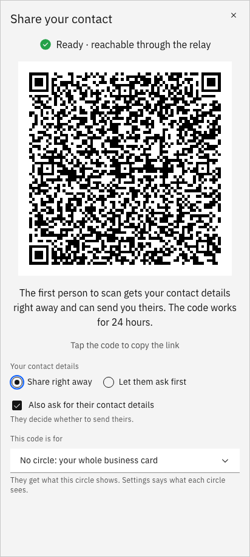
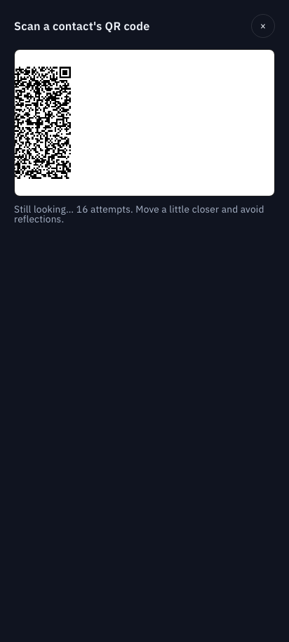
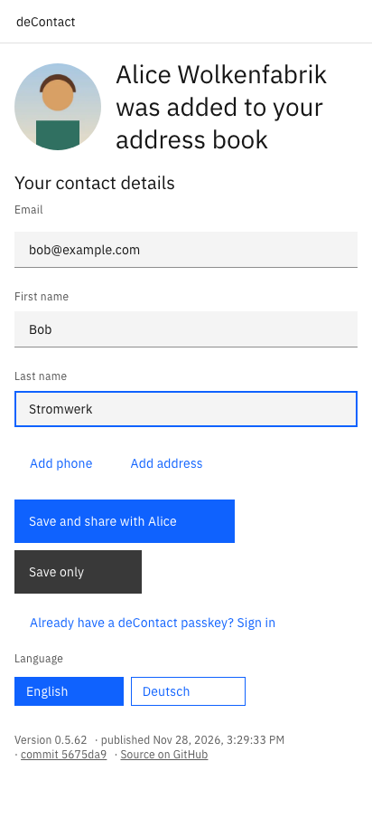
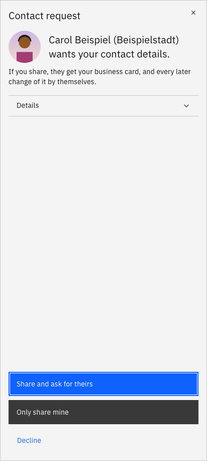
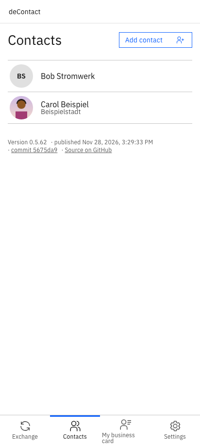
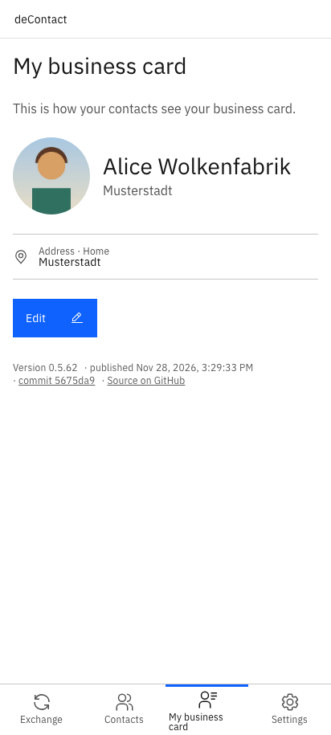

<div align="center">

# deContact

**Self-updating · local · peer-to-peer. An address book whose contacts keep themselves up to date — without a server that owns them.**

[](https://github.com/NiKrause/deContact/actions/workflows/main.yml)
[](https://github.com/NiKrause/deContact/tags)
[](LICENSE)
[](https://nodejs.org)
[](https://www.npmjs.com/package/@le-space/orbitdb-access-controller-decontact)

[](https://libp2p.io)
[](https://helia.io)
[](https://orbitdb.org)
[](https://w3c-ccg.github.io/did-method-key/)
[-informational)](https://w3c.github.io/webauthn/#prf-extension)
[](https://kit.svelte.dev)

</div>

---

## Why deContact
- **Address books go stale.** People move, change their phone number or their email. Whoever has your card keeps the old one until you tell everybody, one by one.
- **Contacts don't belong in someone else's cloud.** They shouldn't live on a platform's servers, tied to its account.

deContact gives every person a self-owned address book. It lives in the browser and syncs peer-to-peer with the people they exchanged cards with. When you change your address, you rewrite your card in every address book you were invited into. Relays only help peers find each other and keep a replica for when you are offline; they can neither read nor change what's in your book.

## Features
- 🔑 **Self-sovereign identity, opened with a passkey.** A passkey opens a vault that holds one root; your `did:key` (Ed25519) and OrbitDB identity are derived from it. No account, no seed phrase, no server-side login ([how](docs/how-it-works.md#identity-passkeys-and-the-vault)).
- 📇 **Your own address book.** An OrbitDB documents database for your card and the cards others write into it. A card holds several phones, emails, addresses and social profiles, each with a label (Mobile, Home, Work …), and a contact's page has notes that only you see ([how](docs/how-it-works.md#what-a-card-holds)).
- ⭕ **Circles.** Put contacts into circles (Family, Friends, Acquaintances, Business, or your own) and choose in **Settings** which fields of your card each circle sees: your card is written separately into each contact's book, so a business contact gets only your work email and profiles, your family everything. A new code gives your whole card unless you choose a circle for it, or one as the default. Moving someone to a smaller circle takes nothing back: what they already received stays with them ([how](docs/how-it-works.md#what-a-card-holds)).
- 🤝 **Exchange cards, peer to peer.** Scan a QR code with the camera, or paste the contact address it shows. The request goes straight to the other person's device over libp2p, with no topic a relay or a third peer could listen on ([how](docs/how-it-works.md#requests)). The other person confirms, and each side writes their card into the other's book. Whoever opens an invitation link from a QR code first gets the card without a confirmation and decides whether to share theirs ([how](docs/how-it-works.md#invitation-links)). On a phone without deContact the form shows at once; the passkey comes after the exchange ([how](docs/how-it-works.md#starting-without-a-passkey)).
- 📲 **An app to install, with link previews.** deContact installs as a PWA and starts without a network; a long press on its icon offers *Show my code* and *Scan a code*. Its link previews and search results are in English at the app's address and in German below `de/`; an invitation link points to the page of the inviter's language ([how](docs/how-it-works.md#pwa-and-link-previews)).
- 🖼️ **A photo on your business card.** Take or pick one under **My business card**: it is cropped square, scaled to 256 × 256 and stored as a small WebP (at most 30 KB) inside the sealed card, without the original's EXIF data or location. Your contacts see it in their list and right after scanning your code ([how](docs/how-it-works.md#what-a-card-holds)).
- 🔄 **Updates follow you.** A changed card is rewritten in every book you were invited into.
- 🛡️ **Signed invitations.** Only invited contacts may write, and only their own card (see [who may write](docs/how-it-works.md#who-may-write-into-an-address-book)).
- 🔒 **End-to-end encrypted.** Every card is sealed to the owner of the book it sits in, every request to its recipient. Relays and the followers who keep a backup hold ciphertext only ([how](docs/how-it-works.md#encryption-sealed-to-the-reader)).
- 🌐 **Direct and relayed.** WebRTC between browsers when possible, a circuit relay otherwise. Relays found through Aleph, or your own.
- 💾 **Offline-friendly.** The relay keeps a replica, so updates reach you after you've been offline.
- 📱 **Multiple devices.** Every passkey you add opens the same vault and writes as the same DID. A synced passkey restores everything on a new device; one that does not sync joins with a device link or your recovery words.
- 🧾 **Recovery words.** Optionally 24 words on paper open the vault when no passkey is at hand.
- 🔍 **Contact list with search.** A Progressive Web App built with SvelteKit and Carbon.
- 🗣️ **English and German.** The app follows your browser's language and can be switched under **Settings** (or on the first screen); both work offline.
- 🌗 **Light and dark.** The app follows your system's setting; **Settings → Theme** picks *Light* or *Dark* instead.

## Screens
<table>
<tr><td align="center" valign="top"><picture><source media="(prefers-color-scheme: dark)" srcset="docs/screens/show-my-code-dark.png"></picture><br><sub><b>Show my code</b><br>ready and reachable: the first person to scan gets the card</sub></td><td align="center" valign="top"><picture><source media="(prefers-color-scheme: dark)" srcset="docs/screens/scan-a-code-dark.png"></picture><br><sub><b>Scan a code</b><br>the camera reads it; the invitation opens</sub></td><td align="center" valign="top"><picture><source media="(prefers-color-scheme: dark)" srcset="docs/screens/invitation-dark.png"></picture><br><sub><b>The invitation</b><br>her card is there; his own in three fields</sub></td></tr>
<tr><td align="center" valign="top"><picture><source media="(prefers-color-scheme: dark)" srcset="docs/screens/request-dark.png"></picture><br><sub><b>A request</b><br>with the asker's photo; the choice is yours</sub></td><td align="center" valign="top"><picture><source media="(prefers-color-scheme: dark)" srcset="docs/screens/contacts-dark.png"></picture><br><sub><b>Contacts</b><br>photo or initials, name, city</sub></td><td align="center" valign="top"><picture><source media="(prefers-color-scheme: dark)" srcset="docs/screens/my-card-dark.png"></picture><br><sub><b>My card</b><br>as your contacts see it</sub></td></tr>
</table>

<sub>On a phone 412 px wide, light or dark as your system is set, from the screen tour (`tests/Screens.spec.js`); the people and their portraits are made up. `node scripts/readme-screens.mjs` copies them again after a tour.</sub>

## How it works
1. Bob scans Alice's QR code (her DID and her device) and sends her a request over libp2p, peer to peer. The request carries the address of his book and a signed invitation.
2. Alice confirms and writes her card into Bob's book. Bob does the same in hers.
3. When either of them changes their card, it is rewritten in every book they were invited into.
4. An [orbitdb-relay](docs/relays.md) connects the browsers when WebRTC can't and keeps a replica for when someone is offline. It checks every entry with the same access controller as the browsers.

→ Step by step, with a sequence diagram and the architecture: [How it works](docs/how-it-works.md)

## Quick start
```bash
git clone https://github.com/NiKrause/deContact.git
cd deContact
pnpm install        # Node.js 22+, pnpm 10 (corepack enable)
pnpm dev
```
The app finds Le Space's relays on Aleph by itself. To try it with two people:
1. Open the app in two separate browsers or browser profiles.
2. In each, choose **Create a new address book** (your browser asks for a passkey twice), then enter your business card under **My business card**.
3. In browser A, open **Exchange → Show my code**, switch to *Let them ask first* and click the code to copy it. In browser B, choose **Exchange → Paste a contact address instead**, paste it and press **Ask**.
4. Choose **Share and ask for theirs** in the browser that is asked, then **Share mine** in the other.
5. Each contact list now shows the other person's business card; your own is under **My business card**.

## Documentation
| Page | Contents |
|---|---|
| [How it works](docs/how-it-works.md) | architecture, the exchange of contact data step by step, who may write into an address book |
| [Relays](docs/relays.md) | Le Space's relays on Aleph, when a relay keeps replicas, running your own (also with Docker) |
| [Configuration](docs/configuration.md) | environment variables of the app and the relay, the WebRTC switch |
| [Development](docs/development.md) | local setup with your own relay, build, tests, project structure |
| [Access controller package](packages/orbitdb-access-controller-decontact) | `@le-space/orbitdb-access-controller-decontact` on npm |

## Known limitations
- **Experimental.** Data formats and protocols may still change; the address book format changed in 0.5.0.
- **Metadata is visible.** Cards and requests are encrypted, but who exchanged cards with whom, and when, is not: a book's address follows from its owner's DID, and whoever opens it sees which DIDs wrote into it. A request travels peer to peer: a relay carrying the circuit sees which two peers talk, and when.
- **A device to ask.** Requests go to a device: the one in the QR code, or for a contact the devices their card names. A stranger's DID alone reaches nobody.
- **Passkeys with PRF.** The browser and the passkey must support the WebAuthn PRF extension (recent Chrome, Safari, Edge; iCloud Keychain, Google Password Manager, 1Password, YubiKey 5). Without it the vault does not open.
- **Security notes.**
  - Nothing secret is stored in the clear: the browser keeps only the sealed vault record, and OrbitDB's keystore lives in memory. While the app is open, the root, the identity's key and its X25519 key are in the page's memory, so a script running in the page could use them.
  - Cards and requests are sealed to the X25519 counterpart of the reader's `did:key`. Signing and decrypting depend on one secret: if the identity's key leaks, both do.
  - Removing a contact removes your card from their book, stops your updates and revokes their invitation into your book: a card they write back with it no longer shows in your list, and their app stops updating it, until you exchange cards again. What they already received stays with them.
  - A revocation is visible in the clear: whoever opens your book sees the document `revoked:<DID>` and so knows that you removed that DID ([#85](https://github.com/NiKrause/deContact/issues/85)). Relays still store a card written under a revoked invitation; your app ignores it ([#93](https://github.com/NiKrause/deContact/issues/93)).
  - Documents written in the clear before the encryption are sealed again on the first start, but the log keeps the old plaintext entries.
  - The first passkey's PRF output is the vault's root, so that passkey alone restores the identity. Removing a passkey revokes nothing it already opened.
  - An identity that began without a passkey after an invitation link has a random root, which the first passkey seals into the vault: restoring it needs the vault record, from OrbitDB and the relays or from the vault file. Until it is secured, it lives in the tab only: closing the tab loses that side of the exchange, and the app warns before it closes.
  - The vault record is public. It is published over OrbitDB (and the relays) under a name only a slot's holder can work out; it names each passkey's credential id and label.
  - Browsers that used the seed phrase lose it on the first start; their old DID and address book are not carried over.
- **Patched OrbitDB.** deContact applies [orbitdb/orbitdb#1260](https://github.com/orbitdb/orbitdb/pull/1260), not yet released, to `@orbitdb/core` 4.0.0, so that entries reach a browser connected only through a relay ([how](docs/how-it-works.md#orbitdb-sync-patch)).
- **WebRTC.** In automated headless tests, browsers only reach each other through the relay. Direct WebRTC between real browsers still needs confirming.

## Contributing
Issues and pull requests are welcome.
- Please run `pnpm test` before opening a PR, and use made-up names and addresses in tests and examples.
- If you find a security issue, please report it privately to the maintainer instead of opening a public issue.

## License
[MIT](LICENSE) © Nico Krause

Built on [libp2p](https://libp2p.io), [Helia](https://helia.io), [OrbitDB](https://orbitdb.org), [SvelteKit](https://kit.svelte.dev) and [Carbon](https://carbon-components-svelte.onrender.com), with relays by [Le Space](https://le-space.de) on [Aleph](https://aleph.cloud).
