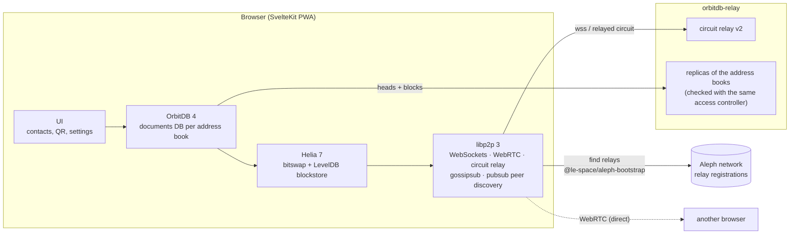
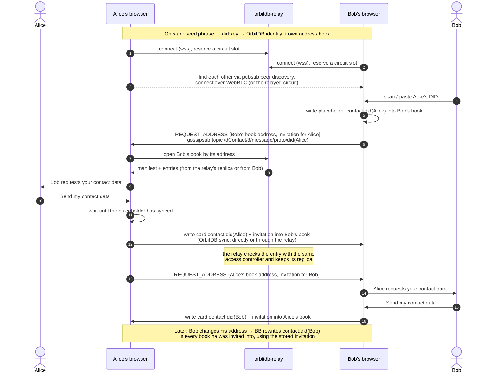

<div align="center">

# deContact

**A local-first, peer-to-peer address book. Your contacts keep themselves up to date — without a server that owns them.**

[](https://github.com/NiKrause/deContact/actions/workflows/main.yml)
[](https://github.com/NiKrause/deContact/tags)
[](LICENSE)
[](https://nodejs.org)
[](https://www.npmjs.com/package/@le-space/orbitdb-access-controller-decontact)

[](https://libp2p.io)
[](https://helia.io)
[](https://orbitdb.org)
[](https://w3c-ccg.github.io/did-method-key/)
[](https://kit.svelte.dev)

</div>

---

> [!WARNING]
> deContact is **experimental software**. Don't use it yet for contact data you need to keep private: address books are not encrypted, and key storage in the browser is not hardened yet.


## Table of contents
- [Why deContact](#why-decontact)
- [Features](#features)
- [How it works](#how-it-works)
  - [Architecture](#architecture)
  - [Exchanging contact data](#exchanging-contact-data)
  - [Who may write into an address book](#who-may-write-into-an-address-book)
  - [Relays](#relays)
- [Getting started](#getting-started)
- [Configuration](#configuration)
- [Testing](#testing)
- [Project structure](#project-structure)
- [Known limitations](#known-limitations)
- [Contributing](#contributing)
- [License](#license)

## Why deContact
- **Address books go stale.** People move, change their phone number or their email. Whoever has your card keeps the old one until you tell everybody, one by one.
- **Contacts don't belong in someone else's cloud.** They shouldn't live on a platform's servers, tied to its account.

deContact gives every person a self-owned address book. It lives in the browser and syncs peer-to-peer with the people they exchanged cards with. When you change your address, you rewrite your card in every address book you were invited into. Relays only help peers find each other and keep a replica for when you are offline; they can't change what's in your book.

## Features
- 🔑 **Self-sovereign identity.** A BIP39 seed phrase gives you a `did:key` (Ed25519), which serves as your OrbitDB identity. No account, no server-side login.
- 📇 **Your own address book.** An OrbitDB documents database for your card and the cards others write into it (private, business or other).
- 🤝 **Exchange cards by DID.** Scan a QR code or paste a DID. The other person confirms, and each side writes their card into the other's book.
- 🔄 **Updates follow you.** A changed card is rewritten in every book you were invited into.
- 🛡️ **Signed invitations.** Only invited contacts may write, and only their own card (see the [access controller](#who-may-write-into-an-address-book)).
- 🌐 **Direct and relayed.** WebRTC between browsers when possible, a circuit relay otherwise. Relays found through Aleph, or your own.
- 💾 **Offline-friendly.** The relay keeps a replica, so updates reach you after you've been offline.
- 📱 **Multiple devices.** The same seed phrase on another device gives the same DID, and the same address book syncs between your devices.
- 🔍 **Contact list with search.** A Progressive Web App built with SvelteKit and Carbon.

## How it works

### Architecture



| Layer | Used for |
|---|---|
| **libp2p** | Connections between browsers and relays: WebSockets to the relay, WebRTC between browsers, circuit relay as fallback, gossipsub for messages and peer discovery |
| **Helia** | Content-addressed blocks (OrbitDB entries, manifests) over bitswap, stored in IndexedDB (LevelDB) |
| **OrbitDB** | One `documents` database per address book, a CRDT log that merges concurrent writes |
| **did:key** | Identity derived from the seed phrase. It signs OrbitDB entries and invitations |
| **orbitdb-relay** | Circuit relay, discovery hub and an always-on replica of the address books |

### Exchanging contact data

Bob scans Alice's DID. Each then writes their own card into the other's address book:



### Who may write into an address book
Every address book uses the OrbitDB access controller `decontact-address-book`, published as [`@le-space/orbitdb-access-controller-decontact`](packages/orbitdb-access-controller-decontact). The app and the relays register the same controller, so all of them accept the same entries:

| Writer | May write |
|---|---|
| The owner, on any device with the owner's DID | anything |
| An invited contact | only their own card: key `contact:<their DID>`, `owner` set to their DID, carrying an **invitation the owner signed** with the Ed25519 key of their `did:key` |
| Anybody else | nothing |

A request for contact data carries the invitation for the recipient. The owner's DID is stored in the database manifest, so a relay can check entries without asking anybody.

### Relays
- **Le Space's relays on Aleph.** At start the app looks up the `orbitdb-relay` instances registered on [Aleph](https://aleph.cloud) (via `api.aleph.im`, [`@le-space/aleph-bootstrap`](https://www.npmjs.com/package/@le-space/aleph-bootstrap)) and dials their secure WebSocket addresses. Browsers find each other on the relays' discovery topic, `todo._peer-discovery._p2p._pubsub`.
- **Your own relay.** `src/relay.js` is [orbitdb-relay](https://github.com/NiKrause/orbitdb-relay) with deContact's access controller. Run it yourself and put its address into `VITE_SEED_NODES`.
- **When the relay keeps replicas.** It replicates address books only if it knows the access controller: deContact's own relay always does, and Le Space's relays from orbitdb-relay 0.11.0 on (via `RELAY_ACCESS_CONTROLLERS`). Without that, contact data arrives only over a direct WebRTC connection between the browsers.

## Getting started

### Prerequisites
- Node.js **22** or newer
- [pnpm](https://pnpm.io) 10 (`corepack enable`)

### Run it locally
```bash
git clone https://github.com/NiKrause/deContact.git
cd deContact
pnpm install
pnpm dev
```
By default the app finds Le Space's relays on Aleph. To work offline or against your own relay, run one and point the app at it:

```bash
pnpm relay                                   # in a second terminal:
curl -s http://127.0.0.1:9090/multiaddrs     # copy the /ws address into .env
```
```bash
# .env
VITE_SEED_NODES_DEV=/ip4/127.0.0.1/tcp/9092/ws/p2p/<peer id of your relay>
VITE_ALEPH_RELAY_DISCOVERY=false
```

### Try it with two people
1. Open the app in two separate browsers or browser profiles.
2. In each, choose **Continue**, then **Generate New**, then enter your card under **My Address**.
3. In browser A, copy the DID from **Settings**. In browser B, paste it under **Contacts** and press **Scan**.
4. Confirm **Send My Contact Data** in both browsers.
5. Each contact list now shows the other person's card.

### Build
```bash
pnpm build      # static build into build/ (adapter-static)
pnpm preview    # serve it locally
```
For hosting below a path (e.g. GitHub Pages), set `BASE_PATH=/deContact` when building.

### Run the relay with Docker
```bash
docker build -t decontact-relay .
# RELAY_PRIV_KEY is optional: without it the relay generates a key and keeps it in the volume
docker run -p 12345:12345 -e RELAY_PRIV_KEY=<hex protobuf private key> -v relay-data:/data decontact-relay
```

## Configuration

App (Vite, at build time; see [`.env.example`](.env.example)):

| Variable | Default | Meaning |
|---|---|---|
| `VITE_SEED_NODES` / `VITE_SEED_NODES_DEV` | *(empty)* | Comma-separated relay multiaddrs dialled first, in production / in `pnpm dev` |
| `VITE_ALEPH_RELAY_DISCOVERY` | `true` | Also look up Le Space's relays on Aleph. If there's no answer within 8 s, only the seed nodes are used |
| `VITE_P2P_PUPSUB` / `VITE_P2P_PUPSUB_DEV` | `todo._peer-discovery._p2p._pubsub` | Comma-separated pubsub peer-discovery topics |
| `BASE_PATH` | *(empty)* | Base path of the build, e.g. `/deContact` |

Relay (`src/relay.js`, [orbitdb-relay environment](https://github.com/NiKrause/orbitdb-relay)):

| Variable | Meaning |
|---|---|
| `RELAY_PRIV_KEY` | Hex protobuf private key for a stable peer id (otherwise one is generated and kept in `DATASTORE_PATH`) |
| `RELAY_WS_PORT` | WebSocket port browsers dial (default `9092`, Docker `12345`) |
| `DATASTORE_PATH` | Where keys, blocks and replicas are stored |
| `PUBSUB_TOPICS` | Discovery topics to forward (default `todo._peer-discovery._p2p._pubsub`) |

In **Settings**, *WebRTC* can be switched off. After a reload, other browsers are then reached only through the relay.

## Testing

```bash
pnpm test            # unit tests (Vitest), then end-to-end tests (Playwright)
pnpm test:unit       # unit tests only
pnpm test:e2e        # E2E: starts its own relay and a production build
pnpm test:e2e:manual # E2E headed, with the Playwright inspector
```

| Suite | What it checks |
|---|---|
| `packages/orbitdb-access-controller-decontact/index.spec.js` | invitations verify only for the invitee; who may write what; the owner is read from the manifest |
| `src/lib/network/*.spec.js` | relay selection with fallback, the production-registration filter, browser-dialable addresses, `ws://` from https pages |
| `tests/AddressArrives.spec.js` | both cards really arrive in the other book, once with WebRTC allowed and once relay-only, and the test logs which way they travelled |
| `tests/BasicAddressExchange.spec.js` | the request / answer dialogs on both sides |
| `tests/MyDevicesAutoSync.spec.js` | a second device with the same seed phrase |

The E2E tests never contact Aleph or public relays: `tests/start-e2e-server.mjs` starts a fresh local relay and builds the app against it. CI runs the same suite on every push and pull request, and deploys to GitHub Pages only from `main` after the tests pass.

## Project structure
```
src/
├── routes/                      SvelteKit pages, onboarding, seed phrase handling
├── lib/components/              contact list and form, QR code, settings, dialogs
├── lib/network/
│   ├── p2p-operations.js        start-up, the request/answer protocol, card updates
│   ├── peer-connectivity.js     dialling discovered peers, WebRTC upgrade, relay reservation
│   ├── seed-nodes.js            relays from Aleph + configured ones
│   └── getIdendityAndCreateOrbitDB.js, identityProvider.js   did:key identity → OrbitDB
├── config.js                    libp2p configuration
└── relay.js                     the relay (orbitdb-relay + deContact's access controller)
packages/
└── orbitdb-access-controller-decontact/   the access controller, published to npm
tests/                           Playwright E2E tests and their server
```

## Known limitations
- **Experimental.** Data formats and protocols may still change; the address book format changed in 0.5.0.
- **Not encrypted.** Contact data in address books is not encrypted yet. Anybody who knows a book's address can read it.
- **Keys in the browser.** The seed phrase is kept in browser storage. Use a separate test seed phrase.
- **WebRTC.** In automated headless tests, browsers only reach each other through the relay. Direct WebRTC between real browsers still needs confirming.

## Contributing
Issues and pull requests are welcome.
- Please run `pnpm test` before opening a PR, and use made-up names and addresses in tests and examples.
- If you find a security issue, please report it privately to the maintainer instead of opening a public issue.

## License
[MIT](LICENSE) © Nico Krause

Built on [libp2p](https://libp2p.io), [Helia](https://helia.io), [OrbitDB](https://orbitdb.org), [SvelteKit](https://kit.svelte.dev) and [Carbon](https://carbon-components-svelte.onrender.com), with relays by [Le Space](https://le-space.de) on [Aleph](https://aleph.cloud).
