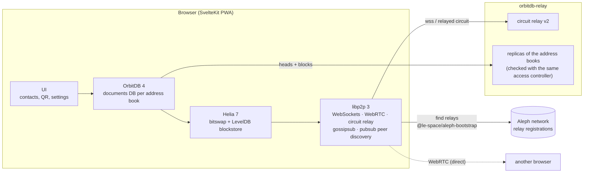
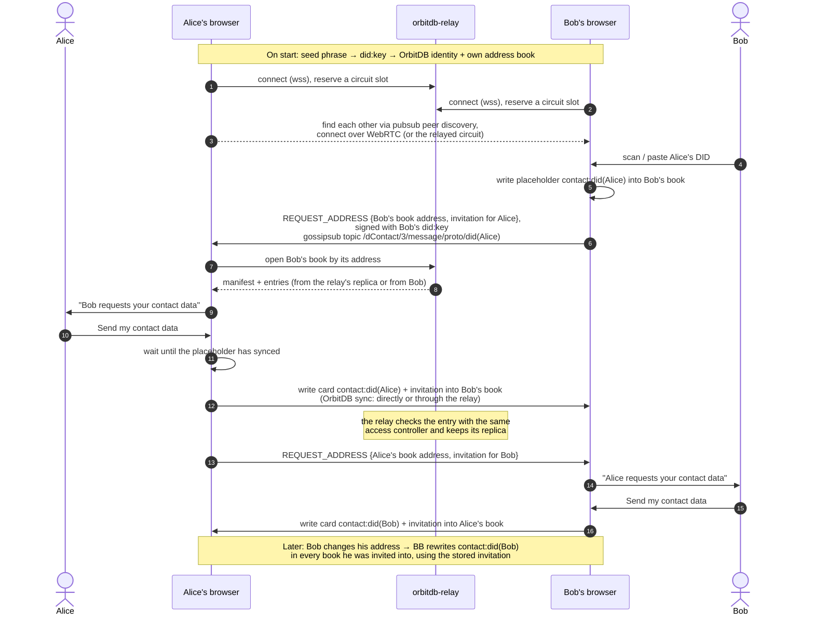

# How deContact works

[README](../README.md) · **How it works** · [Relays](relays.md) · [Configuration](configuration.md) · [Development](development.md)

- [Architecture](#architecture)
- [Exchanging contact data](#exchanging-contact-data)
- [Who may write into an address book](#who-may-write-into-an-address-book)

## Architecture

| Layer | Used for |
|---|---|
| **libp2p** | Connections between browsers and relays: WebSockets to the relay, WebRTC between browsers, circuit relay as fallback, gossipsub for messages and peer discovery |
| **Helia** | Content-addressed blocks (OrbitDB entries, manifests) over bitswap, stored in IndexedDB (LevelDB) |
| **OrbitDB** | One `documents` database per address book, a CRDT log that merges concurrent writes |
| **did:key** | Identity derived from the seed phrase. It signs OrbitDB entries and invitations |
| **orbitdb-relay** | Circuit relay, discovery hub and an always-on replica of the address books |

## Exchanging contact data

Bob scans Alice's DID. Each then writes their own card into the other's address book:

### Requests

Every request is signed with the sender's `did:key`. The signature covers the sender, the recipient, the time, a random nonce, the sender's book address and the invitation ([`contact-messages.js`](../src/lib/network/contact-messages.js)). The recipient drops, without a dialog:

- anything that does not have the shape of a request;
- a request whose signature does not belong to the DID it names as sender;
- a request for somebody else, older or newer than 10 minutes, or seen before;
- a request whose book is not the sender's own (the owner in the book's manifest) or whose invitation is not the sender's.

From each sender only the newest request waits for an answer.

Requests are not encrypted yet: who asks whom, and the address of the requester's book, can be read by anybody subscribed to the topic ([#58](https://github.com/NiKrause/deContact/issues/58)).

### Invitation links

The QR code can carry a link instead of the bare DID. Its token is signed by the inviter and holds a random nonce, an expiry (24 hours) and whether the inviter asks back for the invitee's card. The device that created the link remembers it. The first person who sends a request with it gets the inviter's card without a dialog; their app may resend the request with the same token. Anybody else, and anybody after 24 hours, makes the inviter's app ask as for any other request. So does a link created on another of the inviter's devices.

## Who may write into an address book

Every address book uses the OrbitDB access controller `decontact-address-book`, published as [`@le-space/orbitdb-access-controller-decontact`](../packages/orbitdb-access-controller-decontact). The app and the relays register the same controller, so all of them accept the same entries:

| Writer | May write |
|---|---|
| The owner, on any device with the owner's DID | anything |
| An invited contact | only their own card: key `contact:<their DID>`, `owner` set to their DID, carrying an **invitation the owner signed** with the Ed25519 key of their `did:key` |
| Anybody else | nothing |

A request for contact data carries the invitation for the recipient. The owner's DID is stored in the database manifest, so a relay can check entries without asking anybody.

Where those replicas live, and when a relay keeps one: [Relays](relays.md).
