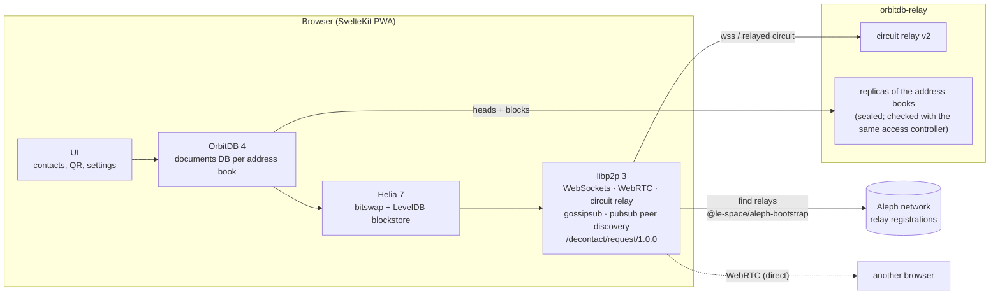
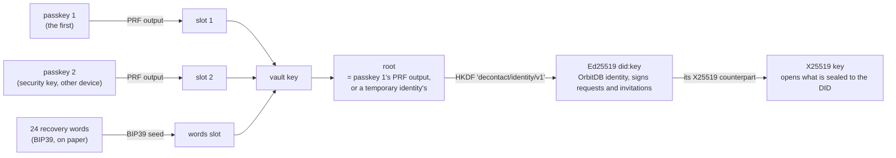
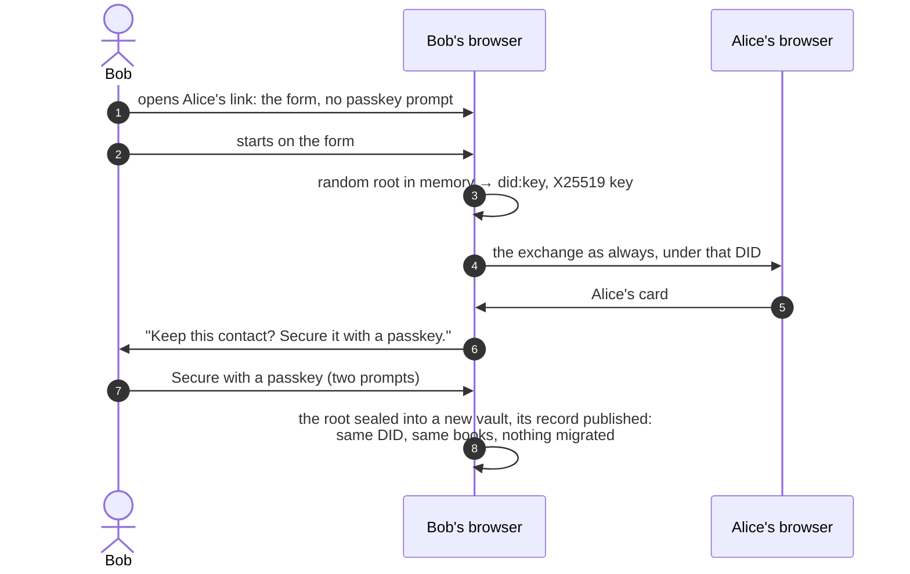
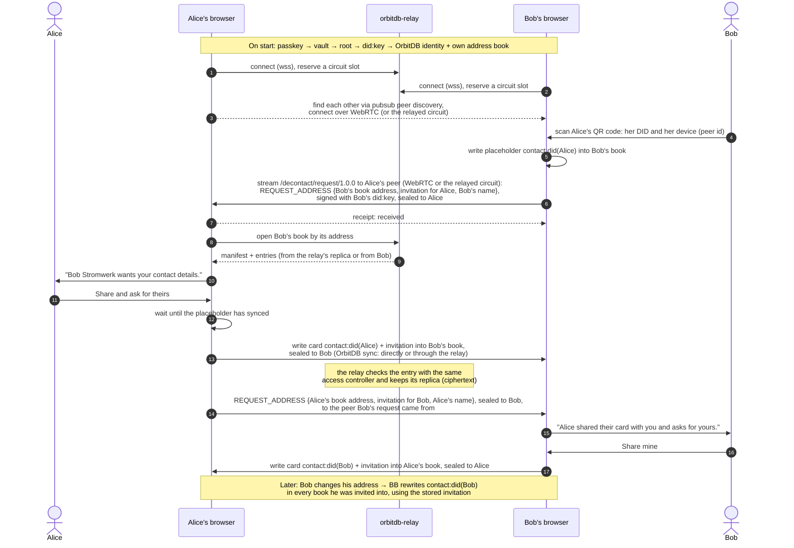
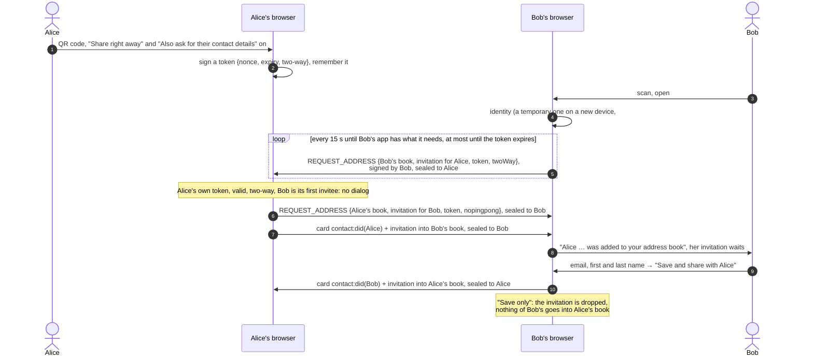

# How deContact works

[README](../README.md) · **How it works** · [Relays](relays.md) · [Configuration](configuration.md) · [Development](development.md)

- [Architecture](#architecture)
- [Identity: passkeys and the vault](#identity-passkeys-and-the-vault)
- [Encryption: sealed to the reader](#encryption-sealed-to-the-reader)
- [Exchanging contact data](#exchanging-contact-data)
- [Who may write into an address book](#who-may-write-into-an-address-book)

## Architecture

| Layer | Used for |
|---|---|
| **libp2p** | Connections between browsers and relays: WebSockets to the relay, WebRTC between browsers, circuit relay as fallback, gossipsub for OrbitDB and peer discovery, and deContact's own protocol for [contact requests](#requests), peer to peer |
| **Helia** | Content-addressed blocks (OrbitDB entries, manifests) over bitswap, stored in IndexedDB (LevelDB) |
| **OrbitDB** | One `documents` database per address book, a CRDT log that merges concurrent writes. 4.0.0 with a [sync patch](#orbitdb-sync-patch) |
| **Passkey vault** | One root secret, opened by any of your passkeys or your recovery words ([below](#identity-passkeys-and-the-vault)) |
| **did:key** | Ed25519 identity derived from the vault's root. It signs OrbitDB entries, requests and invitations; its X25519 counterpart is the key cards and requests are sealed to |
| **orbitdb-relay** | Circuit relay, discovery hub and an always-on replica of the address books |

### OrbitDB sync patch

Until [orbitdb/orbitdb#1260](https://github.com/orbitdb/orbitdb/pull/1260) is released, deContact applies it to `@orbitdb/core` 4.0.0 as a pnpm patch ([`patches/@orbitdb__core@4.0.0.patch`](../patches/@orbitdb__core@4.0.0.patch), `pnpm.patchedDependencies`). It changes only `src/sync.js`, for a reader that reaches a writer only through a third peer such as a relay ([orbitdb#1255](https://github.com/orbitdb/orbitdb/issues/1255)), which is the usual case at a conference, with a phone on mobile data:

- heads learnt through the heads exchange are announced on the topic once, so a peer in the middle passes them on;
- on opening a database, the heads are exchanged with peers that were already subscribed, the relay included;
- the heads handler is registered before subscribing, so an early dial finds it;
- `join` is emitted once per peer;
- heads dials run outside the database's queue: a dial that hangs on a peer reachable only through a relay circuit no longer holds up the exchange with the relay.

The patch applies to every OrbitDB in this repository, the E2E tests' local relay included. Le Space's relays on Aleph run orbitdb-relay with its own OrbitDB, which republishes the heads it syncs by itself.
## PWA and link previews

- **Installable.** The manifest (`static/manifest.json`) starts the app at its own address (`./`, so below `/deContact/` on GitHub Pages), with icons of 192 and 512 pixels, one of them maskable. The E2E test asks Chrome whether it can install the app.
- **Starts without a network.** The service worker keeps the app's files and its page; offline, a reload starts the app from them. Requests to relays and other origins go past it.
- **Link previews and search results.** The app renders in the browser, and crawlers and link previews do not run it. So each language has a page of its own, written at build time with its title, description, Open Graph and Twitter tags, `hreflang` alternates and structured data ([`seo.js`](../src/lib/seo.js), [`hooks.server.js`](../src/hooks.server.js)): English at the app's address, German below `de/`, each with its own picture (`og-image.png`, `og-image-de.png`). The texts come from the language catalogues (`meta.*`). `VITE_SITE_URL` names the public address the tags point to; it defaults to GitHub Pages.
- **An invitation link in the inviter's language.** The QR code's link points to the page of the language on screen, so a messenger shows its preview in that language. The app itself still opens in the language its reader chose before, or their browser's.
- **Which build runs.** Under every screen, the first one included, the app names its version, when it was built (for GitHub Pages: published), its commit with a link to it, and the source on GitHub. The build takes them from `package.json` and git, `GITHUB_SHA` or `git rev-parse HEAD`, and its own clock (`vite.config.js`).
- **One version more with every deploy.** Major and minor come from `package.json`. The patch counts the commits on `main` since the tag of that version (`v0.5.0`): every pull request is merged as one commit, and every push to `main` is deployed, so 0.5.24 is followed by 0.5.25 ([`scripts/app-version.js`](../scripts/app-version.js)). The Pages build checks out the history for it (`fetch-depth: 0`); a checkout without history or tag shows `package.json`'s version as it is. A new minor version starts the count again once its commit is tagged (`v0.6.0`).
- **The pictures.** `scripts/brand/icon.svg` is the source of every icon and the favicon, `scripts/brand/og-image.html` of the previews; `pnpm run brand` renders them into `static/`. They are provisional.

## Accessibility

- **Checked on every screen.** `tests/Accessibility.spec.js` runs axe-core with the rules of WCAG 2.1 A and AA on each screen:
  - the passkey screen: a first start, a kept vault to unlock, and a passkey that opens nothing;
  - the four tabs;
  - the QR code;
  - the invitation form.

  It runs them in English and German, at a desktop's width and a phone's, and one finding fails it. Not covered: the camera (`<qr-scanner>`), which needs a camera, and the passkey step dialog (`<passkey-step-dialog>`), which shows only during a passkey prompt.
- **Names a screen reader says.**
  - Every field has a label. Where it is hidden, a screen reader still reads it.
  - The theme switch is named in the language on screen.
  - The peer icon's colour and number have a hidden text that says both. It is not a live region, because the number changes too often to read it out each time.
  - A row of the contact list is chosen with a radio button named "Open this contact". The table's other hidden texts (expand a row, the search field) are in the language on screen too (Carbon's `translateWithId`).
- **Carbon 0.114, unpatched.** Until [#110](https://github.com/NiKrause/deContact/issues/110), deContact patched a few accessibility errors of carbon-components-svelte 0.82. Carbon 0.114 fixes them itself: a tab's list item is "presentation" again, a row's radio button has a name, an expand cell points at a header that exists, and on a phone the tabs stay tabs (a row that scrolls sideways) instead of a menu whose trigger was a "listbox" without options.

## Identity: passkeys and the vault

deContact has no seed phrase any more ([#60](https://github.com/NiKrause/deContact/issues/60)). A passkey opens a **vault** that holds one 32-byte root, and the identity is derived from that root. The vault, the keeper and the signer come from [`@le-space/orbitdb-identity-provider-webauthn-did`](https://github.com/Le-Space/orbitdb-identity-provider-webauthn-did) (0.14.0); Le-Space/belege keeps its books in the same vault. The glue is in [`src/lib/identity`](../src/lib/identity).

- **One prompt per session.** Unlocking reads the passkey's PRF output once (`readPrfOutput`). The same output opens the vault slot, and the identity comes from the root inside; nothing asks the passkey again. Creating an address book takes two prompts (register, read the PRF output); the second is announced by `<passkey-step-dialog>`.
- **The root.** A new vault takes the first passkey's PRF output as its root, as Belege does. That passkey alone restores everything on an empty device, whether it is synced (iCloud, Google, a password manager) or a security key. An identity that began without a passkey after an invitation link has a random root instead ([below](#starting-without-a-passkey)).
- **One identity for every passkey.** `createSecretSigner(root, { info: 'decontact/identity/v1' })` gives an Ed25519 `did:key` that belongs to no single passkey. Every slot opens the same root, so every passkey writes as the same DID: the DID that owns the address book in the access controller and under which contacts keep the card (`contact:<DID>`). OrbitDB gets it through `OrbitDBWebAuthnIdentityProviderFunction({ signer })`; peers and relays verify it as the provider's `webauthn` identity type.
- **Memory only.** OrbitDB's keystore is `createSessionKeystore({ signer })`: no key lands in IndexedDB. The vault key, the root, the identity's key and its X25519 key ([below](#encryption-sealed-to-the-reader)) live in the page's memory until it closes.
- **What the browser keeps.** The vault record in `localStorage` (`decontact.vaults.v1`): public JSON with the root sealed under a random vault key and one slot per passkey (the vault key sealed under a key derived from that passkey's PRF output). It names each slot's credential id and label, nothing secret. The E2E tests scan `localStorage`, `sessionStorage` and IndexedDB for the root, the identity's key, its X25519 key and the vault key.
- **More passkeys.** Under **Settings** a passkey can be added (two prompts) and removed. A removed passkey is refused on this device, but it has seen the root: removing revokes nothing it already opened.
- **Recovery words.** Under **Settings**, 24 BIP39 words become one more slot (filed under a fixed id, so one set per vault). They are shown once and never stored; replacing them makes the old words useless.

### Starting without a passkey

At a conference stand the exchange should take seconds, and creating a passkey on a new phone does not ([#97](https://github.com/NiKrause/deContact/issues/97)). So a browser that keeps no vault and opens an [invitation link](#invitation-links) shows the form at once, and the passkey comes after the exchange.

- **A temporary identity.** Once the person starts on the form, the app takes a random 32-byte root, in the page's memory only, and derives the Ed25519 `did:key` and its X25519 key from it as from a vault's root (`createSecretSigner(root, { info: 'decontact/identity/v1' })`). OrbitDB runs with `createSessionKeystore`, as for a vault identity. Only then is Alice asked: **Already have a deContact passkey? Sign in** on the form, before that, opens the link again with the passkey screen first, and the link's one-time token is still unused.
- **The exchange as always**, under that DID: Alice invites it, Bob's card goes to `contact:<DID>` in her book, and his book is the book of that DID.
- **The passkey afterwards.** Once a contact's card has arrived, the app offers: "Keep this contact? Secure it with a passkey." *Not now* puts the offer away until another contact arrives or three minutes pass; **Settings** offers it all the time. Creating the passkey (two prompts) seals the temporary root into a new vault (`rootPayload(root)` in that passkey's slot), publishes the vault record as after every change, and turns the session into a vault session without opening anything again. The DID stays, so Alice's invitation, Bob's book and his card in hers stay valid.
- **Two more ways back in**, offered right after and skippable: recovery words, should the passkey be lost, and the vault file, should the network not have the record. The passkey's PRF output is not this vault's root, so restoring it on an empty device needs the record ([below](#a-device-that-has-nothing-yet)).
- **Nothing kept while temporary.** No vault is written, and what the app otherwise keeps in `localStorage` (the links opened, `decontact.exchanges.v1`, and the links issued) is held in memory too ([`held-storage.js`](../src/lib/identity/held-storage.js)), and written once the identity is secured. IndexedDB holds what OrbitDB and Helia write for any identity: the public identity document and the book's entries, whose cards are sealed. The E2E test scans `localStorage`, `sessionStorage` and IndexedDB during the temporary phase, and checks that scan against the root once the passkey has sealed it.
- **Closing the tab** before the passkey loses Bob's side of the exchange; Alice keeps his card. Once his book holds something, the app warns before the tab closes (`beforeunload`), until the identity is secured.
- **A browser that keeps a vault** opens an invitation link with the passkey screen, as before.

### A device that has nothing yet

A new device finds the vault record in one of three places, and the keeper's `find` asks all of them on every unlock:

| Where | How it gets there |
|---|---|
| **OrbitDB, through the relay** | After every unlock and every change the record is published in an OrbitDB event log per slot, named after the slot's lookup id (derived from the slot's secret, so only its holder can name it). The relay replicates it like an address book. Anybody may append, but only a record that opens with the slot's key is taken. |
| **Device link** | **Settings → Link another device**: a link (and QR code) with the record in the URL fragment, which never reaches a server. |
| **Vault file** | **Settings → Download vault file**, imported on the new device's first screen. |

- With the **first passkey**: its PRF output is the root, so the identity comes back even if no record is found - except for an identity that [began without a passkey](#starting-without-a-passkey), whose record must be found as for any other slot.
- With a **second passkey** or the **recovery words**: the record must be found, then it opens. A device whose passkey does not sync opens it with the words and adds its own passkey under **Settings**.
- A passkey that opens nothing gets no new address book without the person saying so.

### Moving from the seed phrase

A browser that still has a seed phrase loses it on the first start: `seedPhrase`, `seed` and the old OrbitDB keystore (`./orbitdb/identities`) are deleted, and the first screen says so. The seed's DID is not the vault's, so the old identity and its address book are not carried over (deContact is a prototype).

## Encryption: sealed to the reader

Only the owner of an address book reads it ([#59](https://github.com/NiKrause/deContact/issues/59)). Bob writes his card into Alice's book, but he reads Alice's card in **his own** book, where she wrote it. Followers and relays replicate a book to keep it available, never to read it. So every document is sealed to the owner of the book it sits in, whoever writes it, and every request to its recipient. The code is in [`src/lib/encryption`](../src/lib/encryption).

| In Alice's book | Written by | Sealed to | Read by |
|---|---|---|---|
| her own card, placeholders, the books she was invited into | Alice | Alice | Alice's devices |
| Bob's card (`contact:<Bob's DID>`, with Alice's invitation) | Bob | Alice | Alice's devices |
| the whole log | | | replicated by the relay and by followers as a backup: ciphertext |

- **The key is the DID.** The X25519 counterpart of an Ed25519 `did:key` is its key-agreement key (the did:key method defines it, libsodium calls it `crypto_sign_ed25519_pk_to_curve25519`). Anybody works it out from the DID alone. So there is no key directory, nothing to look up before the first request, and no key anybody could register under somebody else's DID. The private half comes from the same seed as the identity's Ed25519 key (`deriveSubkey(root, 'decontact/identity/v1')`), so every passkey and every device has it. It is imported into WebCrypto as a key that cannot be extracted.
- **A seal.** A fresh ephemeral X25519 key pair; HKDF-SHA256 over the shared secret, with both public keys as salt and `decontact/seal/v1` as info; AES-GCM-256 with a fresh nonce. The additional data names what was sealed and where it belongs (the book's owner and the document's `_id`, or the request's recipient): a seal moved elsewhere does not open there. Ported from simple-todo `privacy01` (`key-wrapping.js`, `db-encryption.js`).
- **Cards.** A document keeps in the clear what the [access controller](#who-may-write-into-an-address-book) checks: its `_id`, and on a contact's card also `owner` and `invitation`. Everything else (names, address, email, [photo](#what-a-card-holds), the address of the writer's own book) goes into `sealed`. The controller and its rules did not change, so relays still check every entry without a key. OrbitDB's own `encryption.data` is not used: it seals the whole payload, and a relay without the key would see no key, owner or invitation and would refuse every contact's card.
- **Requests.** The signed request is sealed to the recipient and [delivered to their device](#requests) as `{ v: 3, sealed }`. Inside are the signed request and the sender's name (first name, last name, city), because the recipient can no longer read the sender's book to see who asks.
- **Removing a contact.** Deleting somebody's card under **Contacts** asks first ("Remove Bob Stromwerk?", [#110](https://github.com/NiKrause/deContact/issues/110)), then removes our card from their book, so no later change of ours reaches them, and removes their card, placeholder and book from ours. It also [revokes their invitation](#removing-a-contact-revokes-their-invitation) into our book. What they already received stays with them.
- **Entries from before.** Documents of the own book that were written in the clear before this change are sealed again when the app starts. The log keeps the old plaintext entries.

### What a card holds

| Field | | In the clear? |
|---|---|---|
| `_id` | `contact:<DID>` on a contact's card | yes |
| `owner`, `invitation` | the writer's DID and the owner's signed invitation, on a contact's card | yes |
| `firstName`, `lastName`, `organization` | the name, and an optional organisation | no, sealed |
| `phones`, `emails`, `addresses`, `social` | entries with a label, see below | no, sealed |
| `email`, `street`, `postalCode`, `city`, `countryRegion` | the first email and the first address again, for older app versions; `category` on a card from before #109 | no, sealed |
| `photo` | a small photo, see below | no, sealed |
| `sharedAddress` | the address of the writer's own book | no, sealed |
| `own` | marks the owner's own card, only in the owner's book | no, sealed |

**Entries** ([#109](https://github.com/NiKrause/deContact/issues/109)). Besides the name, a card holds repeatable entries with a label, as a phone's own address book and vCard do: `phones: [{ label, value }]` (Mobile, Home, Work, Other), `emails: [{ label, value }]` (Private, Work, Other), `addresses: [{ label, street, postalCode, city, countryRegion }]` (Home, Work, Other) and `social: [{ network, handle }]` (Mastodon, Bluesky, LinkedIn, GitHub, Instagram, X, Website, Other). The order is the person's: the first of each kind is the primary one, and its city is the line under the name in the contact list, after an organisation if there is one ([`entries.js`](../src/lib/card/entries.js)).

- **Older cards.** A card from before #109 has one email and one address in flat fields and a `category` (private / business / other). It reads as the first email and the first address, labelled after the category: private → Private / Home, business → Work, other → Other.
- **The form** shows what is filled in, plus a button to add more: the name, *Organization (optional)*, then each kind that has entries, each entry with its label in a small select in front of the field and a remove button ("Remove phone 2"), and *Add phone*, *Add email*, *Add address* or *Add profile* under it; a kind without entries is only its button. A new entry gets a label: the first phone Mobile, a second Work, the first address Home, the first email Work. One column on a phone, two for the name and the postal code and city from about 600 px on. Every field has its `type`, `inputmode` and, on one's own card, `autocomplete` (`tel`, `email`, `street-address`, `postal-code`, `address-level2`, `country-name`), so a phone shows the right keyboard and can fill in its owner's data; on a contact added by hand the browser offers nothing. A profile that is not of its network's form says under the field that it shows as text. Nothing is deleted before saving; saving trims every field and leaves out the empty entries ([`ContactForm.svelte`](../src/lib/components/ContactForm.svelte)).
- **Limits.** At most 5 entries of each kind, and a length per field (100 characters for a name or an organisation, 40 for a phone number, 254 for an email address, 200 for a street or a profile, 20 for a postal code, 100 for a city or a country). A field over its length is marked as one types; a card over the limits is not saved, and a notice says so.
- **Older app versions** (a cached PWA on another phone) read and write only the flat fields, so the first email and address are written there too, with every save. Where the flat fields differ from the first entry, an older version changed them, and they win: the first entry takes their value, or goes if they are empty.
- **Checked as read.** A card comes from its owner's app, which may be any app. Only strings count, an unknown label or network reads as Other, each kind has at most 5 entries, and each field a length (for example 40 characters for a phone number, 254 for an email address).
- **Links.** On a contact's page a phone number is a `tel:` link and an email a `mailto:` link, each only when it has the form of one (digits and the usual separators; one `@`, nothing that adds a recipient or a header), and an address can be copied. A social profile is a link only for a known network, built by the app from a handle of that network's form (`@name@server` for Mastodon, a domain for Bluesky, the user name for the others; a web address for a website, without a user name or password in it). Anything else shows as text, never as a link.

**My notes** ([#109](https://github.com/NiKrause/deContact/issues/109)). A contact's page has *My notes*: where we met, what we talked about. They are one's own, never shared. A contact's card is written by the contact, so a note cannot live in it: their next update would overwrite it, and it would travel back to them. A note is a document of its own in one's own book, `{ _id, about, note, changedAt }` with `about` the contact's DID, sealed to the book's owner like every document there; one's other devices replicate the book, so it reaches them, and a contact cannot write it (the access controller lets them write only `contact:<their DID>`). Its key is random, `about:<16 random bytes>`, not `note:<their DID>`: every contact keeps a copy of one's book, and the keys are in the clear there, so a key that named them would show a contact that one keeps a note on them. *Save note* saves it; an empty note takes the document away, and so does removing the contact ([`about.js`](../src/lib/card/about.js)). Two devices that each wrote one about the same contact before they synced: the later counts.

**Circles** ([#100](https://github.com/NiKrause/deContact/issues/100)). A contact can be in a circle, and gets only the fields of one's card that the circle shows; the name always, so that the card can be recognised. One's card is already written separately into each contact's book, sealed to them ([`cardFor`](../src/lib/network/p2p-operations.js)): a circle only decides which fields that copy holds. No group keys, no extra books, no change to the access controller or the relays.

- **The circles** are Family, Friends, Acquaintances and Business, and what each shows is a list of fields: the photo, the organisation, each kind of entry with each label (`phones.work`, `addresses.home`) and each social network on its own (`social.github`). Family shows everything; Friends everything but what is labelled Work; Acquaintances the photo, the mobile phone, the emails and the profiles; Business the photo, the organisation, the mobile and work phones, the work and other emails, the work address and LinkedIn, GitHub, Mastodon, Bluesky and a website ([`circles.js`](../src/lib/card/circles.js)). They are the document `settings:circles` of one's own book, sealed, so all one's devices share them; until there is one, the app uses these.
- **Settings → Circles** shows them as a matrix, the fields as rows and the circles as columns, with a checkbox each (the name is always on the card); on a narrow phone the matrix scrolls inside its box. The circles can be renamed (a default circle without a name of its own shows its name in the language on screen), added and removed, from 3 to 6, and *A new code is for* chooses the default for a new code: *No circle: your whole card* in a new address book (decided with Nico; #100 had proposed Business), or a circle. *Save circles* saves the document and writes one's card into every contact's book again, with what their circle shows now.
- **A contact's circle** is chosen on their page (*Circle*), and kept in one's own document about them (see *My notes*), never in their card: they do not see which circle they are in, only which fields arrive. A contact without a circle, which every contact from before is, gets the whole card, as before.
- **A new contact's circle.** *Show my code* has *This code is for*: the default for a new code from Settings, another circle, or *No circle: your whole card*. The choice stays on the device that issued the code, with its one-time token, not in the link ([`contact-messages.js`](../src/lib/network/contact-messages.js)): whoever opens the link joins that circle before one's card goes to them. Somebody whose request one accepts in the dialog gets the whole card, as before; their page chooses a circle. One's card going back to the person whose link one opened (*Save and share*) carries no circle: it is what one typed for them. A contact who already has a circle keeps it.
- **Writing.** Every time one's card goes into a contact's book, after an update, after their request, or when their circle changes, it holds what their circle shows: the entries filtered, the first email and address for older app versions taken from what is left, the photo and the organisation only where shown. What the app needs to work (the book's address, one's devices, the invitation) stays.
- **Moving someone to a narrower circle takes nothing back.** What they received stays with them, and the log of their book keeps the older versions of the card, as with removing a contact. The page says so when the new circle shows less.

**The start screen** ([#110](https://github.com/NiKrause/deContact/issues/110), Phase 4). While the vault is shut, the app shows one column: on a wide screen a tile in the middle, with room below the header; on a phone the screen's width, 16 px in from its edges. It starts with the name, the icon and the line *self-updating · local · peer-to-peer* (in German *Selbstaktualisierend · Lokal · Peer-to-Peer*, each word with a capital; a narrow screen breaks it at a dot, never inside a word), then a few sentences on what deContact is, what it is good for (whoever has your business card still reaches you after you move or change jobs) and why it asks for a passkey (no account, no password, no server that keeps the contacts). Below them *Why is this useful?* unfolds the examples: people met at a conference, in training, at university or at work lose touch when one moves, changes jobs, phone numbers or email addresses, or leaves a social network; with deContact they get the new details by themselves. Folded, it keeps the screen short for a hurried first start. Then the note that it is experimental. Then one primary button across the column: *Unlock with passkey* where the browser keeps a vault, else the passkey's name and *Create a new address book*. Below it, quieter and starting where the text starts, the other ways: another passkey (or *Sign in with an existing passkey*), the recovery words, a vault file from another device. The language switch and the version line are flush with the column. The header names the app only; the line on what it is moved here ([`PasskeyGate.svelte`](../src/lib/components/PasskeyGate.svelte)).

**The app's places** ([#110](https://github.com/NiKrause/deContact/issues/110)). Four, each at its own address, in a navigation at the bottom of the screen on a phone and the open Fold and in a rail on the left on a desktop: **Exchange** (`#/`, the start screen: a status line, the exchanges still waiting, and two big buttons under the thumb, *Show my code* and *Scan a code*; *Paste a contact address instead* below them), **Contacts** (`#/contacts`), **My business card** (`#/card`) and **Settings** (`#/settings`, with the network, which had a *Statistics* tab of its own). The browser's back button and a reload keep the place. On a desktop each place is a column of 40rem in the middle of the room beside the rail, at least 3rem from it and from the screen's edge (Contacts: its two panes, up to 62rem), and Exchange's block sits in the middle of the screen's height instead of at its top; the version line is part of the column, flush with it at every width, as on the start screen.

**Where a card shows** ([#110](https://github.com/NiKrause/deContact/issues/110)). The own card (`own`) is under **My business card**, shown as others see it (photo or initials, name, and every entry with its label), with *Edit*, which opens the form; *Cancel* drops the changes, *Update* saves them and shows the card again. Before its first save, that place is the empty form for it, under three lines on why: what the card is, that only the people one exchanges with can read it, and that they get every change by themselves. A new address book opens there on the first start; *Later* goes to Exchange, which then says to fill the card in. Somebody who came through an [invitation link](#invitation-links) fills in the onboarding form instead. **Contacts** shows everybody else, one row per person: their photo or initials, the name, and their organisation or the city of their first address; a search from ten contacts on. A row opens the contact's page: on a phone and the open Fold instead of the list, on a desktop beside it (the list on the left, 20rem wide and kept in view while the page scrolls, the contact open marked in it; before one is chosen, the pane says to choose one). The page is their card as they share it, read-only, in words (each entry with its label: a phone number calls, an email writes, an address reads in lines and can be copied), with the DID and the book address under a collapsed *Technical details*, and *Remove contact*, which asks first. The page reads the book, so a change of theirs shows while it is open. *All contacts* goes back where the list is not beside the page. *Add contact* opens the form, empty, for a contact added by hand, in the same place as a contact's page; such a contact is ours and opens in the form again, to edit or delete.

**The photo** ([#87](https://github.com/NiKrause/deContact/issues/87)). Under **My business card**, *Choose photo* takes a picture from the phone's camera or gallery, or a file. The app crops it to its centre square, scales it to 256 × 256 pixels on a canvas and encodes it as WebP, or as JPEG where the browser does not encode WebP (Safari). It lowers the quality until the image fits into 30 KB. Encoding a canvas writes the pixels and nothing else, so the EXIF block of the original, with any location, does not survive. The card carries the photo as a data URL (`data:image/webp;base64,…`) under `photo`, sealed with the name and the address: it travels through the relays like the rest of the card, arrives while its owner is offline, and only the card's reader opens it. *Remove photo* and *Update* take it off the card in every book. The photo shows in the contact list, in a contact's details and on the [onboarding](#invitation-links) screen once the inviter's card has arrived ([`photo.js`](../src/lib/photo/photo.js)).

- **Size.** A card with a photo of 30 KB is below 60 KB sealed (base64 twice: the data URL, then the seal). libp2p streams, gossipsub and bitswap accept 4 MiB for one message, and orbitdb-relay sets no limit of its own on entries. Every update of a card writes the photo into the log again; the cap keeps that small.
- **Only a photo is shown.** A card comes from its owner's app, which may be any app. A `photo` is shown only if it is a WebP or JPEG data URL of at most 64 KB; a link (which would load something from elsewhere when shown), an SVG or anything bigger is not.
- **Later.** A separate block over IPFS/Bitswap, encrypted with its own key that goes into the sealed card, would allow bigger images and avoid rewriting the photo on every update. A relay would need to keep such blocks, which it cannot see inside a sealed card.

What stays visible:

- **Who writes into whose book, and when.** An address book's address follows from its owner's DID. Whoever opens it sees which identities wrote entries, the `_id`s (a contact's card is `contact:<their DID>`), the invitations and the entry sizes. A request shows its recipient (the topic), its time and the sender's libp2p peer id.
- **What a contact received stays theirs.** Removing them stops the updates; it cannot take back what they saw.
- **That we keep notes.** Whoever replicates our book sees how many `about:` documents it holds and how big they are, not whom they are about or what they say.
- **Whom we removed.** A [revocation](#removing-a-contact-revokes-their-invitation) is the document `revoked:<their DID>`: whoever opens our book sees that we removed that DID, and when the entry was written ([#85](https://github.com/NiKrause/deContact/issues/85)).
- **One secret for signing and decrypting.** The identity's Ed25519 key and its X25519 key are one secret. If it leaks, both leak. Reusing it this way is established practice (did:key, libsodium, age), and both would come from the same root anyway.

## Exchanging contact data

Bob scans Alice's DID. Each then writes their own card into the other's address book. (Opening Alice's [invitation link](#invitation-links) instead goes without a dialog.)

### Requests

Every request is signed with the sender's `did:key`, the identity of their vault, then sealed to the recipient ([above](#encryption-sealed-to-the-reader)). The signature covers the sender, the recipient, the time, a random nonce, the sender's book address, the invitation, the sender's name, a small copy of their photo and, for an [invitation link](#invitation-links), its token and whether the sender asks for an invitation (`twoWay`) ([`contact-messages.js`](../src/lib/network/contact-messages.js)). The recipient drops, without a dialog:

- anything that is not sealed to them, or does not have the shape of a request (`twoWay` without a token, for example);
- a request whose signature does not belong to the DID it names as sender;
- a request for somebody else, older or newer than 10 minutes, or seen before;
- a request whose book is not the sender's own (the owner in the book's manifest) or whose invitation is not the sender's.

From each sender only the newest request waits for an answer.

**The asker's photo** ([#110](https://github.com/NiKrause/deContact/issues/110)). When the sender's card has a [photo](#what-a-card-holds), the request carries a small copy of it, 64 × 64 pixels, WebP (JPEG where the browser makes no WebP), at most 6 KB ([`photo.js`](../src/lib/photo/photo.js) `thumbnailOf`). It is a field of its own at the top level of the signed request, `photo`, not part of the name (`from`): an app from before checks the name field by field and would drop the whole request for an unknown one, while it ignores an unknown top-level field. The request stays far below the 16 KB a signed request may have, so older apps still take it. The recipient shows the photo next to the name in the request dialog only when it is a WebP or JPEG data URL within the limit (`isThumbnail`), as an `` like a card's photo; anything else is dropped, and the request still counts. Like the name, the photo is what the sender put on their own card: it says who they claim to be, not who they are.

**Peer to peer.** A request goes to the recipient's device on deContact's own libp2p protocol, `/decontact/request/1.0.0` ([`contact-protocol.js`](../src/lib/network/contact-protocol.js)): one stream, over WebRTC or a relay's circuit, carrying the sealed request and, back, a receipt that it arrived and opened. There is no topic per DID any more, so no relay subscribes to anything for it and no third peer sees a request go by. A relay that carries the circuit sees that two peers talk, when and how much; the request itself is sealed end to end.

- **Whom to dial.** A DID does not say where its owner's app runs. The QR code names the device: the invitation link carries `&peer=<peer id>`, and the contact address for the Scan field is `<DID>?peer=<peer id>` ([`contact-address.js`](../src/lib/network/contact-address.js)). The recipient answers to the peer the request came from.
- **Scanning.** *Scan a code* on **Exchange**, the start screen ([#110](https://github.com/NiKrause/deContact/issues/110)), opens the camera, one tap from opening the app: the `<qr-scanner>` element of [`@le-space/libp2p-webrtc-qr`](https://www.npmjs.com/package/@le-space/libp2p-webrtc-qr), as its demo uses it, loaded on the first scan ([`QrScanner.svelte`](../src/lib/components/QrScanner.svelte)). It reads with the browser's `BarcodeDetector` or jsQR, releases the camera on every way out, and says in its own dialog why it cannot (no https, refused, no camera). An invitation link it reads opens in this app; a contact address becomes a request. A code that is neither keeps the camera running and says so. With a contact address pasted into the field, *Scan* sends it.
- **The devices in the card.** Each device adds its peer, with when it was seen, to its owner's own card (`devices`, [`devices.js`](../src/lib/network/devices.js)). The card goes into every contact's book, sealed to that book's owner, so only contacts learn the devices; neither a relay nor a stranger does. The card changes only for a new device or one not seen for 7 days, so the books' logs grow little, and a device not seen for 60 days drops out with the next change. So a contact's DID alone reaches them: the app asks the device named first, then the one their last request came from, then the devices of their card, most recently seen first. A stranger's DID alone reaches nobody, and the app says so: for them there is the QR code. Where libp2p knows no address of that peer yet (pubsub peer discovery announces browsers every few seconds), it is dialled through each relay we are connected to: `<relay>/p2p-circuit/p2p/<peer>`, where browsers hold their reservations.
- **Resends.** An app in the background does not answer the protocol, so the sender's app tries again, with growing pauses, until a receipt comes back; after that, the card comes by OrbitDB. A resend names the request it repeats (`resentOf`, that request's timestamp by the sender's clock, signed with the rest; the placeholder keeps it across a reload). The recipient remembers the timestamp of the last request of that sender it answered in the dialog: a resend of that request or an earlier one asks nobody again, while a request made anew (scanning again, asking back) always asks ([`answered.js`](../src/lib/network/answered.js)).

### Invitation links

The onboarding at a conference ([#86](https://github.com/NiKrause/deContact/issues/86)): Alice shows a QR code, Bob opens the link, gets Alice's card at once, quickly types his own and decides whether Alice gets it too.

The QR dialog (*Share your contact*) offers two choices, and one sentence under the code says what happens when somebody scans it:

- **Share right away** (the default): the code is a link, `#/onboarding/<Alice's DID>?onBoardingToken=…`. The first person who opens it gets Alice's card at once. Its token is signed by Alice and holds a random nonce, an expiry (24 hours) and whether a **two-way exchange** is allowed: the option *Also ask for their contact details*, on by default ("They decide whether to send theirs."). The device that created the link remembers it. Alice's card is not in the QR code: anybody who photographs the code would have it.
- **Let them ask first**: the code is Alice's contact address, `<Alice's DID>?peer=<her device>`, without a token. Only deContact's own Scan reads it; whoever scans it sends Alice a request, and she decides in the request dialog ([Requests](#requests)).

**Getting ready** ([#110](https://github.com/NiKrause/deContact/issues/110)). Above the code, the dialog first shows what the app and the network do, each step *done*, *in progress* or *needs attention*: the address book is open; the network has started (this device's peer goes into the code); a relay is connected; the relay holds a reservation for this device, a `/p2p-circuit` address through which the other phone reaches it even where WebRTC is blocked; the invitation link is signed (a contact address needs none); and the card has a name, or at least an email (else *Fill in my card*, which goes to My card). The code shows once the book, the network, the link and the card are there. Relay and reservation may come later: the other phone resends its request until it is answered, so holding the code back on bad Wi-Fi would stop the exchange entirely. After 10 seconds without them, the dialog says that they can scan now and the exchange completes once both are online. With every step done, the list folds into one line, *Ready · reachable through the relay*. Exchange's status line says the same in a few words ([`readiness.js`](../src/lib/network/readiness.js)).

- **The first person** who sends a request with the token gets Alice's card without a dialog. Anybody else, anybody after 24 hours, and a link created on another of Alice's devices make her app ask, as for any other request; the resends of a request she answered in the dialog ask her no second time.
- **The form.** While Alice's card is on its way, Bob's app shows the form, and above it, with a spinner, "The business card of the person who invited you is on its way…": her name is not known yet, and her DID is no name ([#110](https://github.com/NiKrause/deContact/issues/110)). Once it is there, her name and [photo](#what-a-card-holds) take that place. The form: email, first name and last name first, a phone number behind *Add phone* and the address behind *Add address* ([#109](https://github.com/NiKrause/deContact/issues/109)): the exchange at a stand does not get slower. The email alone is enough. They become the first entry of each kind on Bob's card; whatever else his card holds, he fills in later under *My card*. Bob chooses **Save and share with Alice** (*Save and share* until her name is known) or **Save only**, and a spinner says what his app does ("Saving your card and sending it…") until his card is in his own book. Then his address book opens: sending the card to Alice, and asking her phone again, go on in the background, so the form never waits for the other phone; a link without a two-way exchange, or one whose token does not check out against the DID in it, offers only **Save**. No request dialog appears during the onboarding: a request of Alice's that arrives before Bob saves waits for his choice, and *Save only* declines it, as *Decline* does in the dialog. Bob's app writes no placeholder card of his own (his DID as the last name) anywhere.
- **Sharing back without being asked.** Bob may write into Alice's book only with an invitation she signed for his DID, and she cannot sign one before she knows it. So, when the token allows a two-way exchange, Bob's request carries `twoWay: true`: "send me an invitation, in case I share". For her own valid token and its first invitee, Alice's device answers without asking: a request with her invitation, `nopingpong` and the same token, which tells Bob's app what it answers. It writes no placeholder for Bob into her book and does not resend. Bob's app asks for the invitation together with the card, so that it is there while Alice still holds her phone, and uses it only if he shares. After *Save and share* it asks until the invitation has arrived.
- **Waiting for Alice's phone.** A PWA in the background does not answer the protocol. Bob's app resends the request with the same token every 15 seconds until Alice's card (and, after *Save and share*, her invitation) has arrived, until the token expires, and says "Waiting for Alice's phone…" ("Waiting for the phone of the person who invited you…" until her card is there; never her DID). His choice is kept in `localStorage` (`decontact.exchanges.v1`; in memory until a [temporary identity](#starting-without-a-passkey) is secured) until the token expires: an invitation that comes after a reload is used, or declined, without asking him again ([`exchanges.js`](../src/lib/network/exchanges.js)).
- **Both ways stay current.** Alice remembers Bob's book (a hidden record in hers), so a later change of her card reaches him even when he saved only. After *Save and share* his changes reach her the same way.
- **Apps from before #86.** The token's format did not change; its last field was "request address from peer". An older app that opens a new link gets Alice's card only. A request from an older app of Alice's, which asked Bob back on its own, waits for his choice like any request of hers.

## Who may write into an address book

Every address book uses the OrbitDB access controller `decontact-address-book`, published as [`@le-space/orbitdb-access-controller-decontact`](../packages/orbitdb-access-controller-decontact). The app and the relays register the same controller, so all of them accept the same entries:

| Writer | May write |
|---|---|
| The owner, on any device with the owner's DID | anything |
| An invited contact | only their own card: key `contact:<their DID>`, `owner` set to their DID, carrying an **invitation the owner signed** with the Ed25519 key of their `did:key`. These fields stay in the clear; the rest of the card is sealed to the owner |
| Anybody else | nothing |

A request for contact data carries the invitation for the recipient. The owner's DID is stored in the database manifest, so a relay can check entries without asking anybody.

The end-to-end test [`WriteAccess.spec.js`](../tests/WriteAccess.spec.js) proves these rules through the app and the relay ([#81](https://github.com/NiKrause/deContact/issues/81)): somebody who was not invited cannot write their own card, the owner's card or any other document, nor delete one; an invited contact cannot overwrite the owner's card or write a card under another DID. Each write is refused in the writer's browser, and a fresh browser that opens the book through the relay alone finds none of them. It writes through `window.__decontactE2E`, a hook only the build for the tests has ([`e2e-hook.js`](../src/lib/network/e2e-hook.js)); CI checks that the production build, and the one GitHub Pages publishes, contains none ([`check-production-build.mjs`](../scripts/check-production-build.mjs)).

### Removing a contact revokes their invitation

An invitation never expires: the access controller checks only that the owner signed it. So removing Bob ([#82](https://github.com/NiKrause/deContact/issues/82)) also revokes the invitation Alice once gave him, in the app and without changing the controller, the invitation format or the relays ([`revocations.js`](../src/lib/network/revocations.js)):

- **The revocation.** Alice's app writes `revoked:<Bob's DID>` into her own book: `_id`, her DID as `owner`, the time. It is sealed to her like every document, so only the `_id` stays in the clear. Only the owner may write a key other than `contact:<own DID>`, so Bob can neither write nor delete it.
- **Alice's app ignores Bob's card.** While the revocation is there, her address list and her backups leave out `contact:<Bob's DID>`, whenever and however often he writes it. That is sound because only Bob, or Alice herself, may write under that key.
- **Bob's app stops writing.** It sees `revoked:<Bob's DID>` in its copy of Alice's book, writes no update of his card there any more and shows no message. Alice's card, if he still has it, stays in his book. A link of Bob's that Alice opened is no longer resent to him: every resend would invite him again.
- **Inviting again.** Every request that carries an invitation for Bob (Alice scans him, answers his request and asks him back, or sends him an invitation for a two-way exchange) deletes the revocation first. His card counts again, the one he wrote in the meantime too, until his app replaces it.
- **What the relays do.** They check entries with the same controller and still accept a card under a revoked invitation; they store it, and Alice's app ignores it. Refusing it there needs the controller to see the book's state, a release of the package and of orbitdb-relay, and a redeploy ([#93](https://github.com/NiKrause/deContact/issues/93)). It would save storage only: an invited contact can write their card as often as they like anyway.

Where those replicas live, and when a relay keeps one: [Relays](relays.md).
